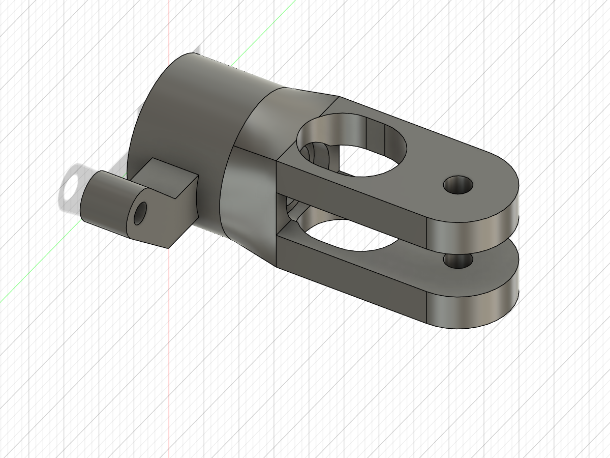

# Helicad

RC helicopter blade-grip CAD exploration and nominal assembly-clearance checks.

## Current design

Revision R7 targets a reference-style, one-piece grip with bottom insertion of the metal bearing stack.

- [Fusion archive](helidesign/grip-r7-fit-only.f3d)
- [STEP model](helidesign/grip-r7-fit-only.step)
- [Dimensioned reference drawing (PDF)](helidesign/grip-r7-dimensioned-reference.pdf)
- [Dimension schedule (CSV)](helidesign/grip-r7-dimensions.csv)
- [Prototype STL](helidesign/grip-r7-fit-only.stl)
- [Assembly notes](helidesign/r7-assembly-notes.md)
- [Project status](helidesign/PROJECT-STATUS.md)
- [Complete saved backup](helidesign-backup.zip)

## Status

**Unpowered fit prototype only. Not validated for flight.** The user target is 240 g total takeoff mass and 4,000 RPM; these are requirements, not demonstrated capabilities.

Nominal bottom insertion was checked using continuous swept-envelope intersections against the plastic. Shaft retention, bearing preload, actual hardware interfaces, printed tolerances, fatigue and operating strength remain unverified. No structural FEA solve has run. The CAD material was last inspected as default Steel, not a validated material assignment for the intended print.

Earlier revisions, source scripts, research notes, clearance results and preliminary load calculations are preserved under `helidesign/`. Earlier 200 g targets are superseded by 240 g. Earlier plate-stress estimates do not validate the current geometry.

## Reproducing the CAD

The Python scripts use Autodesk Fusion's `adsk` API. Each defines `run(_context: str)` and creates a new design. Export directories are specific to the original workspace and must be changed before running elsewhere.

The reference photos/manuals are linked in the research notes where available; external reference images were not included in this saved deliverable set. No manufacturing or flight suitability is claimed.

The dimensioned PDF is a companion to the STEP, not embedded STEP PMI. It documents existing nominal geometry; manufacturing tolerances are TBD. Wireframe projections include hidden edges without hidden-line classification. It is not a production drawing.

